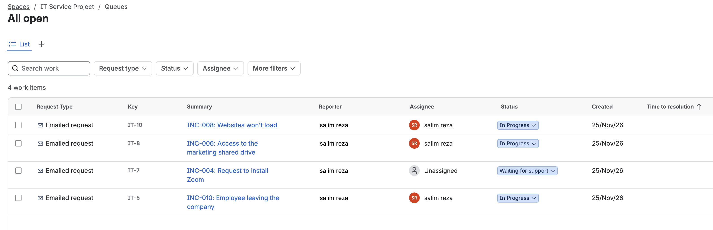
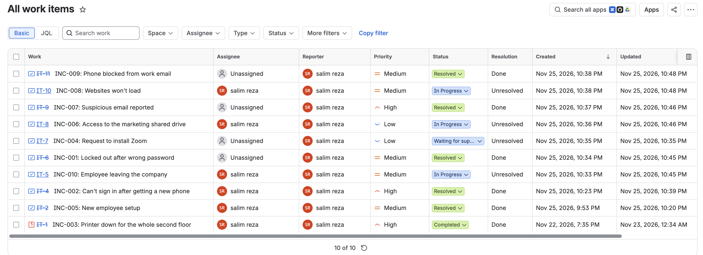
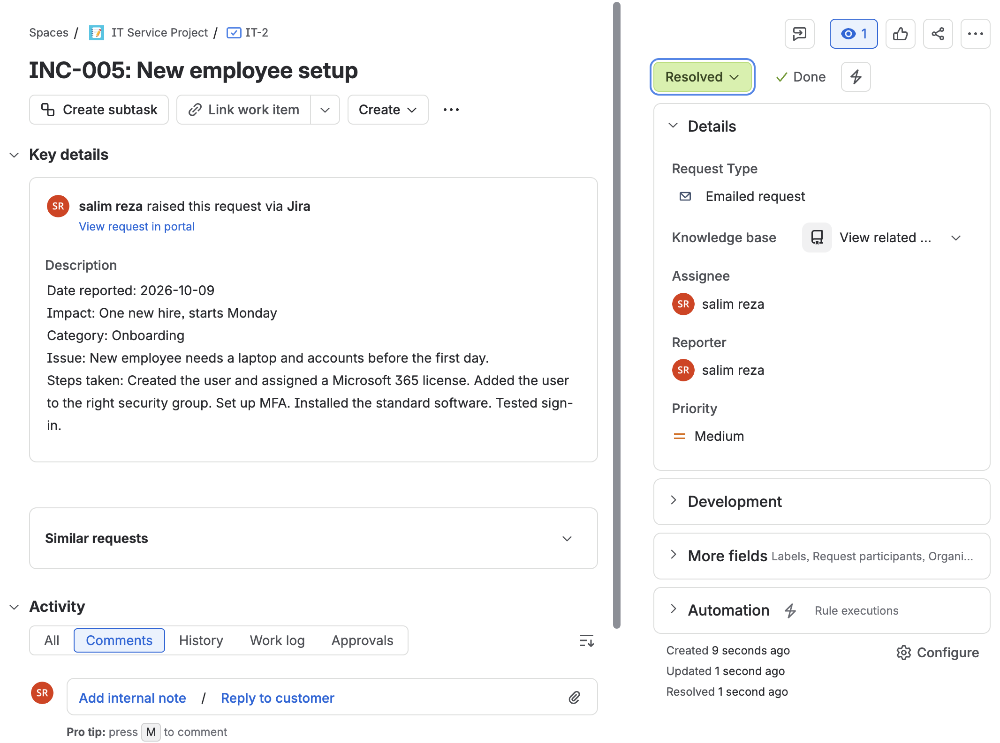
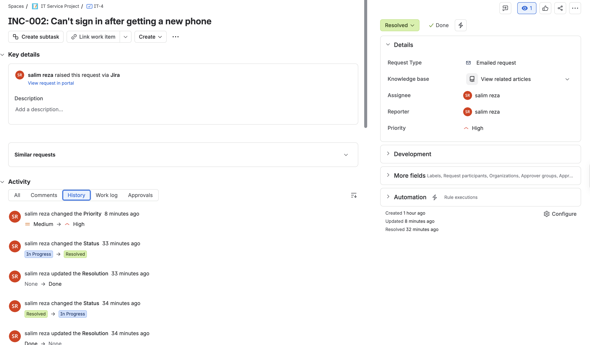

# Jira Helpdesk Lab

In this lab I used Jira Service Management to work like a real IT helpdesk. I created my 10 portfolio tickets in Jira, moved them through the steps, and closed them with a resolution.

## What I did

1. Made a free Jira Service Management site and an IT Service Project space.
2. Created 10 tickets (INC-001 to INC-010). These are the same tickets as in my [Helpdesk Tickets](https://github.com/sreza0134-dev/IT-Support-Administration-Portfolio/tree/main/02-Helpdesk-Tickets) folder.
3. Set the priority for each ticket: High, Medium or Low.
4. Assigned the tickets to myself.
5. Moved them from Waiting for support, to In progress, to Resolved.
6. Added a resolution (Done) and a comment with the steps and the time to resolve.

## The tickets

| Ticket | Title | Priority | Status |
|---|---|---|---|
| INC-001 | Locked out after wrong password | Medium | Resolved |
| INC-002 | Can't sign in after getting a new phone | High | Resolved |
| INC-003 | Printer down for the whole second floor | High | Resolved |
| INC-004 | Request to install Zoom | Low | Waiting for support |
| INC-005 | New employee setup | Medium | Resolved |
| INC-006 | Access to the marketing shared drive | Low | In progress |
| INC-007 | Suspicious email reported | High | Resolved |
| INC-008 | Websites won't load | Medium | In progress |
| INC-009 | Phone blocked from work email | Medium | Resolved |
| INC-010 | Employee leaving the company | Medium | In progress |

I left some tickets open on purpose, so the queue looks like a real helpdesk with work still running.

## Screenshots

**Open queue**
Only the tickets that are not closed yet.

**All tickets**
All 10 tickets with priority, status and resolution.

**A resolved ticket (INC-005)**

**Ticket history (INC-002)**
The history shows every change: assigned, in progress, resolved, and priority.

## What I learned

- How a ticket moves from new to in progress to resolved.
- Priority depends on how many users are affected and how urgent it is.
- A resolution and a short comment make a ticket easy to understand later.
- The history tab shows who changed what and when.
- Two ticket types can have different steps in Jira (for example, an incident and an emailed request).

## Tools

- Jira Service Management (free plan)
